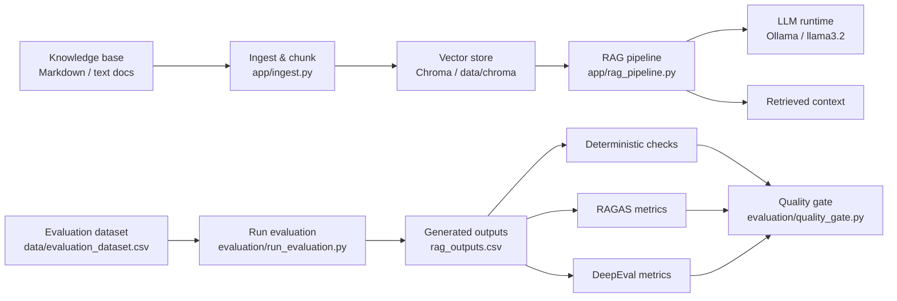

# RAG Evaluation Project

This project builds a lightweight retrieval-augmented generation (RAG) pipeline over a small knowledge base and evaluates the answers against a labeled dataset.

### Architecture overview



### Stack

- LangChain + Chroma for document ingestion and vector retrieval
- CSV-based evaluation dataset for prompt/answer testing
- deterministic checks plus RAGAS and DeepEval scoring for quality assessment
-- Ollama for embeddings and LLM inference


The project expects the following local Ollama models to be available:
- `llama3.2` for the main RAG pipeline and DeepEval judge
- `nomic-embed-text` for embeddings
- `qwen2.5:7b` for the RAGAS evaluator

## Project goals

The application answers questions using content from the documents in `data/documents/` and measures whether:
- the correct source document was retrieved,
- the answer is grounded in the retrieved context,
- unsupported or ambiguous questions are handled appropriately,
- evaluation metrics remain above the configured quality thresholds.

## Repository structure

- `app/ingest.py` – loads Markdown/text files and creates the Chroma vector store
- `app/rag_pipeline.py` – question answering pipeline using retrieval + Ollama
- `data/documents/` – source knowledge base files
- `data/evaluation_dataset.csv` – test cases for evaluation
- `evaluation/run_evaluation.py` – runs the RAG pipeline over the dataset and stores outputs
- `evaluation/deterministic_checks.py` – checks answer correctness, refusal behavior, and retrieval quality
- `evaluation/ragas_evaluator.py` – computes RAGAS metrics from the generated outputs
- `evaluation/deepeval_evaluator.py` – runs DeepEval metric checks on selected cases
- `evaluation/quality_gate.py` – compares metric results against minimum quality thresholds
- `tests/` – ingestion and retrieval regression tests

## Prerequisites

1. Python 3.10+
2. Ollama installed and running locally
3. Required local models pulled into Ollama:

```bash
ollama pull llama3.2
ollama pull nomic-embed-text
ollama pull qwen2.5:7b
```

## Setup

Create a virtual environment and install dependencies:

```bash
python -m venv .venv
source .venv/bin/activate
pip install -r requirements.txt
```

## Ingest the knowledge base

This creates or refreshes the Chroma vector database in `data/chroma/`:

```bash
python app/ingest.py
```

## Run the RAG pipeline manually

```bash
python - <<'PY'
from app.rag_pipeline import RAGPipeline

rag = RAGPipeline()
print(rag.ask('How do I cancel my subscription?'))
PY
```

## Run evaluation

Generate raw answer outputs for the evaluation dataset:

```bash
python evaluation/run_evaluation.py
```

This writes results to `evaluation/results/rag_outputs.csv`.

Then generate the supporting evaluation outputs and run the quality checks:

```bash
python evaluation/deterministic_checks.py
python evaluation/ragas_evaluator.py
python evaluation/deepeval_evaluator.py
python evaluation/quality_gate.py
```

The project also includes a `tests/` suite to validate ingestion behavior.

```bash
pytest
```

## Expected outputs

Evaluation artifacts are stored under `evaluation/results/`:

- `rag_outputs.csv` – raw model responses
- `deterministic_results.csv` – deterministic pass/fail checks
- `ragas_results.csv` – metric scores from the RAGAS pipeline
- `deepeval_results.csv` – DeepEval metric outputs

## Quality gate

`evaluation/quality_gate.py` checks whether the model meets minimum thresholds for:
- `faithfulness`
- `answer_relevancy`
- `answer_correctness`
- `context_precision`

It also ensures deterministic evaluation checks pass and exits with:
- status code `0` when the gate passes
- status code `1` when the gate fails

## Notes

- The vector store is persisted in `data/chroma/` to avoid re-indexing on each run.
- The app is intentionally small and designed for experimentation with RAG behavior and evaluation workflows.
- This project assumes Ollama is available on `http://localhost:11434`.

## Troubleshooting

If you see connection issues with Ollama, confirm the service is running:

```bash
ollama serve
```

If embeddings or model generation fail, confirm the required models were pulled:

```bash
ollama list
```
